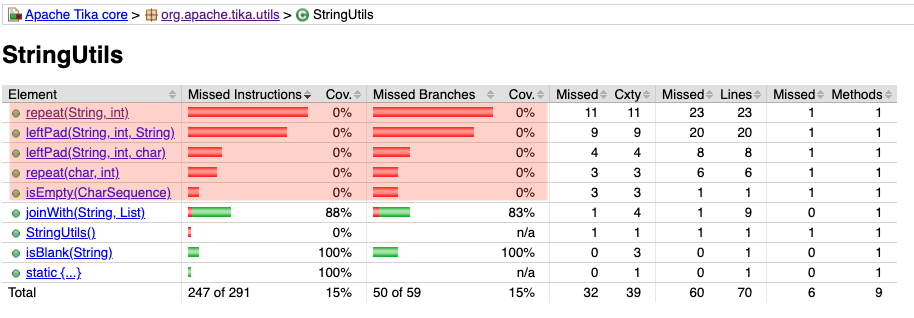
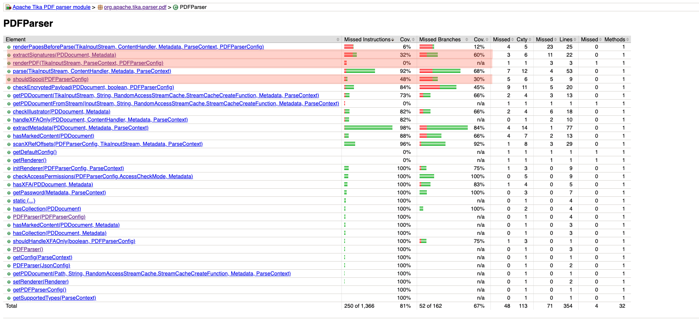
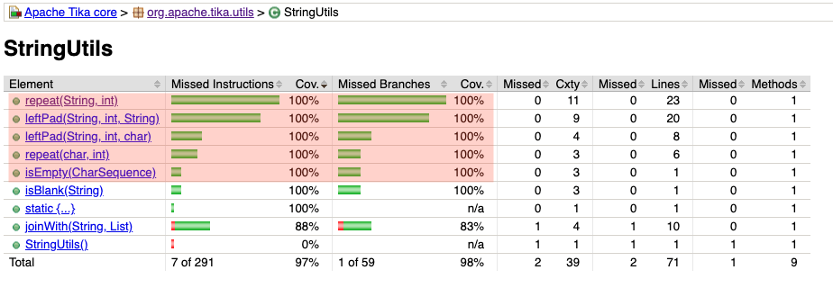
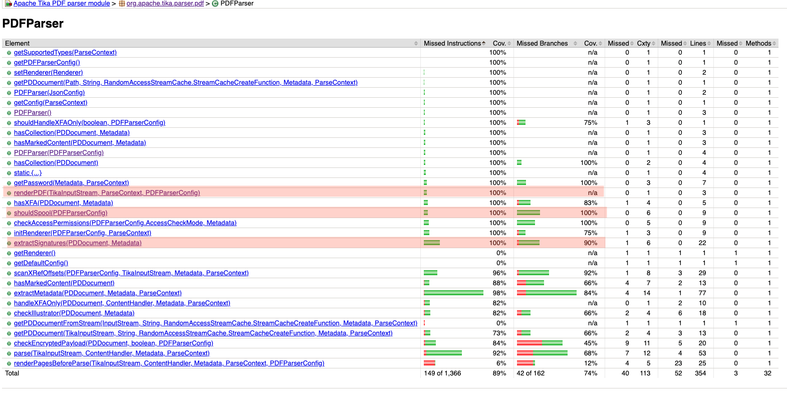

# IFT 3913 — Devoir 1
## Tests unitaires automatisés avec ChatUniTest & Analyse de mutation avec PITest

### Équipe

| Membre | Matricule |
| :--- | :---: |
| **Hung Nguyen** | 20246446 |
| **Olivier Larue** | 20269986 |

Travaux réalisés pour la **Tâche 2** sur le projet [Apache Tika](https://github.com/apache/tika). 
Il couvre la justification des classes cibles, 
l'intégration de **ChatUniTest** avec un LLM, 
l'analyse des tests générés, l'analyse de mutation avec **PITest**, 
l'ajout de tests manuels ciblés pour éliminer les mutants survivants,
ainsi que l'intégration des nouveaux tests dans les **GitHub Actions**.

---

## Sommaire

1. [Classes et méthodes sélectionnées](#1-justification-des-classes-et-méthodes-sélectionnées-classes-à-tester)
2. [ChatUniTest](#2-intégration-de-chatunitest-dans-le-pipeline-maven-ia-et-test)
3. [Tests générés par ChatUniTest](#3-tests-générés-par-chatunitest-tests-générés)
4. [Analyse des tests générés](#4-analyse-et-critique-des-tests-générés-documentation-tests)
5. [Mutation avec PITest](#5-analyse-de-mutation-avec-pitest-mutation--documentation-mutants)
6. [Tests écrits à la main](#6-tests-supplémentaires-écrits-à-la-main-tests-supplémentaires)
7. [Exécution GitHub Actions](#7-intégration-continue--exécution-github-actions-exécution)

---

## 1. Justification des classes et méthodes sélectionnées *(Classes à tester)*

Deux classes ont été sélectionnées dans les modules autorisés :
1. **`PDFParser`** dans `tika-parser-pdf-module` (couverture initiale : **81%**)
2. **`StringUtils`** dans `tika-core` (couverture initiale : **15%**)

`PDFParser` la classe possède son propre fichier de test (`PDFParserTest`),
mais ne couvre pas 100% du code et laisse des mutants vivants.

`StringUtils` illustre un cas particulier. 
La classe n'avait aucun fichier de test dédié (pas de `StringUtilsTest.java`).
Pourtant, elle était déjà testée à **15%** de façon indirecte : PITest montre que les mutants de `StringUtils.isBlank` 
sont tués par `FilenameUtilsTest` et `InputStreamDigesterTest`. La classe avait donc déjà des tests, mais elle ne couvrait 
pas 100% du code : les méthodes `isEmpty`, `leftPad` et `repeat`, par exemple, n'étaient jamais atteintes.
Comme nous avions déjà `PDFParser` comme cas « classique », nous avons trouvons intéressant d'ajouter ce cas 
pour montrer qu'une classe sans fichier de test dédié peut voir une partie de son comportement testée depuis les test d'une autre classe. 
Le fichier `StringUtilsTest.java` a été généré avec LLM.

### 1.1. Justification

| Module | Classe cible | Méthode cible | Couverture initiale | Justification & Mutants vivants |
| :--- | :--- | :--- | :--- | :--- |
| **`tika-core`** | `StringUtils` | `isEmpty` | 0% | **Atteignabilité nulle** : Méthode jamais invoquée par les tests existants. Tout les mutants survivaient. |
| **`tika-core`** | `StringUtils` | `leftPad`  | 0% | **Atteignabilité nulle** : Aucune surcharge appelée. Tous les mutants survivaient. |
| **`tika-core`** | `StringUtils` | `repeat` | 0% | **Atteignabilité nulle** : Aucune surcharge appelée. Tous les mutants survivaient. |
| **`tika-parser-pdf`** | `PDFParser` | `renderPDF` | 0% | **Appelant inatteignable** : Appelée uniquement par `renderPagesBeforeParse` qui quitte prématurément car `RENDER_PAGES_BEFORE_PARSE` n'était jamais activé dans les tests originaux. |
| **`tika-parser-pdf`** | `PDFParser` | `extractSignatures` | 32.7% inst, 60% branches | **Branche morte** : Les tests testaient seulement des champs non signés (`signature == null`). Le bloc d'extraction des métadonnées numériques (lignes 413–427) n'était jamais exécuté. |
| **`tika-parser-pdf`** | `PDFParser` | `shouldSpool` | 48.1% inst, 30% branches | **Branches non couvertes & oracle faible** : Les stratégies `RENDER_PAGES_*` n'étaient jamais testées. De plus, spooler ne modifie pas le texte extrait par les tests, laissant survivre les mutants inversant les booléens. |

### 1.2. Couverture JaCoCo initiale

#### `StringUtils` (15% de couverture initiale)


#### `PDFParser` (81% de couverture initiale)


---

## 2. ChatUniTest

L'outil **[ChatUniTest](https://github.com/ZJU-ACES-ISE/ChatUniTest)** a été configuré au niveau de Maven dans `pom.xml` et `tika-parent/pom.xml` via le plugin officiel. Le modèle retenu est le modèle ouvert **`qwen3.5:4b`**, servi localement par **Ollama** (API compatible OpenAI) :

```xml
<plugin>
  <groupId>io.github.zju-aces-ise</groupId>
  <artifactId>chatunitest-maven-plugin</artifactId>
  <version>2.1.1</version>
  <configuration>
    <url>http://localhost:11434/v1/chat/completions</url>
    <model>qwen3.5:4b</model>
    <apiKeys>
      <openaiKey>ollama</openaiKey>
    </apiKeys>
    <maxRounds>3</maxRounds>
    <testNumber>3</testNumber>
  </configuration>
</plugin>
```

> **Limite matérielle :** le laptop utilisé pour la génération n'était pas assez performante pour héberger `qwen3.5:4b` 
> localement et générer des tests dans un temps raisonnable. Les tests ont donc été générés en remplaçant l'URL par un 
> proxy local compatible OpenAI (`http://127.0.0.1:8085/chat/completions`) qui relayait les requêtes vers **Gemini**. 
> Les tests présentés dans ce rapport proviennent donc de Gemini, et non d'un modèle ouvert exécuté localement.
> La config Ollama ci-dessus est celle à utiliser sur un ordinateur capable d'héberger le modèle.
---

## 3. Tests générés par ChatUniTest

La génération s'est effectuée méthode par méthode via la commande Maven :
```bash
mvn chatunitest:method -pl <module-path> -DselectMethod=<ClassName>#<methodName>
```

Les tests générées et intégrées dans le code sont réparties comme suit :

1. **`tika-core`** :
   - Fichier : `tika-core/src/test/java/org/apache/tika/utils/StringUtilsTest.java`
   - Méthodes couvertes :
     - `isEmpty(CharSequence cs)` (5 tests : `null`, vide, non-vide, espaces blancs, `StringBuilder`)
     - `leftPad(String, int, String)` (7 tests : branches structurelles, répétition, ajustement exact)
     - `leftPad(String, int, char)` (4 tests : cas normal, dépassement `PAD_LIMIT`)
     - `repeat(char, int)` (2 tests : sortie rapide `<= 0`, boucle de remplissage)
     - `repeat(String, int)` (6 tests : `null`, répétitions négatives/nulles, identité, switch cases)

2. **`tika-parser-pdf-module`** :
   - Fichiers générés sous `tika-parsers/tika-parsers-standard/tika-parsers-standard-modules/tika-parser-pdf-module/src/test/java/org/apache/tika/parser/pdf/` :
     - `PDFParser_renderPDF_10_0_Test.java` : Teste `renderPDF` avec un mock de `Renderer` injecté par réflexion.
     - `PDFParser_extractSignatures_7_0_Test.java` : Teste `extractSignatures` avec mocks de `PDDocument` et `PDSignature` pour valider les champs signés.
     - `PDFParser_shouldSpool_8_0_Test.java` : Teste les branches décisionnelles de `shouldSpool` par réflexion.

 Ces fichiers contiennent les tests tels que générés, après les corrections pour compiler et passer Checkstyle. Voir section 4.1).
 Les tests écrits à la main sont dans des classes séparées, voir section 6 :
 - `tika-core/src/test/java/org/apache/tika/utils/StringUtilsManualTest.java`
 - `tika-parser-pdf-module/src/test/java/org/apache/tika/parser/pdf/PDFParserManualTest.java`
---

## 4. Analyse et critique des tests générés

### 4.1. Autonomie de génération et corrections manuelles nécessaires

Les tests générés par ChatUniTest **ne compilaient et ne s'exécutaient pas directement sans intervention manuelle**.
Cinq catégories d'ajustements ont été requises :
1. **Violation des règles Checkstyle (`AvoidStarImportCheck`) :**  
   ChatUniTest génère systématiquement des imports wildcard (ex. `import static org.junit.jupiter.api.Assertions.*`). Apache Tika impose un Checkstyle strict interdisant les imports étoile. Tous les imports ont dû être convertis en imports explicites.
2. **Dépendances de test manquantes (`mockito-core`) :**  
   ChatUniTest utilise abondamment Mockito (`mock()`, `when()`) pour isoler les composants complexes comme `PDDocument`. Ces dépendances ont dû être vérifiées et déclarées dans le scope `<scope>test</scope>` du sous-module.
3. **Nettoyage des binaires orphelins dans `target/test-classes/` :**  
   Pendant la recherche itérative, ChatUniTest compile des classes temporaires. En cas d'échec, des fichiers `.class` orphelins subsistent dans `target/test-classes/`, causant des échecs de build avec Surefire.
4. **Indexation SPI / Composants Tika :**  
   Pour les classes annotées `@TikaComponent` (comme `PDFParser`), un re-build (`mvn compile`) est nécessaire pour régénérer `META-INF/services/` afin d'éviter l'erreur `Unknown component type`.
5. **Test dépendant du système d'exploitation (`PDFParser_renderPDF_10_0_Test`) :**  
   ChatUniTest a passé le dossier courant comme fichier d'entrée : `TikaInputStream.get(Paths.get("."))`. Linux accepte d'ouvrir un dossier, donc le test passe en CI, mais Windows le refuse (`AccessDeniedException: .`) et fait échouer `mvn install`. Comme le `Renderer` est simulé par un mock, le contenu du flux n'est jamais lu : il a été remplacé par un flux vide, `TikaInputStream.get(new byte[0])`.

### 4.2. Comparaison qualitative des oracles : IA vs Écrits à la main

| Dimension | Tests générés par ChatUniTest | Tests écrits à la main |
| :--- | :--- | :--- |
| **Exploration des branches** | **Excellente** : Identifie très efficacement toutes les combinaisons `if/else`, les gardes et les structures de contrôle. | **Ciblée** : Couvre les cas limites d'affaires mais peut oublier des branches secondaires de performance. |
| **Mocks et réflexion** | **Très bonne** : Génère automatiquement le code de réflexion (`setAccessible(true)`) pour les méthodes privées et initialise les mocks. | **Excellente** : Mocks plus précis, vérifications comportementales (`verify()`, `ArgumentCaptor`). |
| **Précision des oracles (Assertions)** | **Faible** : Tend à générer des vérifications superficielles comme `assertNotNull(result)` (inutile si le mock renvoie un objet factice non nul) ou des assertions directes sur la valeur de retour sans vérifier les effets de bord. | **Forte et spécifique** : Vérification exacte de l'état, vérification des exceptions, interception des arguments et assertions d'identité mémoire (`assertSame`). |
| **Propagation** | **Faible** : Ne vérifie pas si l'état infecté se propage aux composants aval (ex. si `shouldSpool == true` déclenche réellement l'écriture disque). | **Élevée** : Conception de tests d'intégration ou d'écouteurs validant la chaîne complète d'exécution. |

### 4.3. Gains de couverture après intégration (JaCoCo)

| Classe cible | Couverture initiale (Baseline) | Couverture après ChatUniTest | Amélioration |
| :--- | :---: | :---: | :---: |
| **`StringUtils`** | 15% inst / 15% branches | **97%** inst / **98%** branches *(100% sur méthodes cibles)* | **+82%** |
| **`PDFParser`** | 81% inst / 67% branches | **89%** inst / **74%** branches *(100% inst sur méthodes cibles)* | **+8%** global *(+50% cibles)* |

#### `StringUtils` (Après génération : 97% de couverture)


#### `PDFParser` (Après génération : 89% de couverture)


---

## 5. Analyse de mutation avec PITest

### 5.1. Configuration de PITest
PITest 1.17.1 a été configuré dans Maven avec le groupe de mutateurs **`STRONGER`** et le plugin JUnit 5 :

```xml
<plugin>
  <groupId>org.pitest</groupId>
  <artifactId>pitest-maven</artifactId>
  <version>1.17.1</version>
  <dependencies>
    <dependency>
      <groupId>org.pitest</groupId>
      <artifactId>pitest-junit5-plugin</artifactId>
      <version>1.2.1</version>
    </dependency>
  </dependencies>
  <configuration>
    <mutators><mutator>STRONGER</mutator></mutators>
  </configuration>
</plugin>
```

### 5.2. Comparaison des scores de mutation

Les scores portent uniquement sur les mutants des **méthodes ciblées**
(`isEmpty`, `leftPad`, `repeat` pour `StringUtils` ; `renderPDF`, `extractSignatures`, `shouldSpool` pour `PDFParser`). 
Un mutant `TIMED_OUT` est compté comme détecté.   
Pour `StringUtils`, PITest génère 98 mutants sur toute la classe ; les 12 mutants de `isBlank` et `joinWith` (méthodes non ciblées) sont exclus, ce qui laisse 86 mutants.  
Pour `PDFParser`, PITest génère 278 mutants sur toute la classe ; seuls les 32 mutants des trois méthodes ciblées sont retenus,
d'où le 32 :(278 − 246 non couverts = 32).  
Tous les scores ont été obtenus avec Java 21, comme dans la GitHub Action.

| Module | Classe cible | Score initial (tests originaux) | Score avec ChatUniTest | Mutants survivants |
| :--- | :--- | :---: | :---: | :---: |
| **`tika-core`** | `StringUtils` | **0%** (0 / 86, tous non couverts) | **76.7%** (66 / 86) | **20** |
| **`tika-parser-pdf`** | `PDFParser` | **12.5%** (4 / 32 ; 10 survivants, 18 non couverts) | **81.2%** (26 / 32) | **6** |

- **Tests originaux de `StringUtils`** : tous les tests de `tika-core` (aucun fichier `StringUtilsTest` n'existait). Ils ne touchent que `isBlank` (5 mutants tués par `FilenameUtilsTest` et `InputStreamDigesterTest`), jamais les méthodes ciblées.
- **Tests originaux de `PDFParser`** : tous les tests du module PDF, sauf les tests générés et manuels. Les 4 mutants tués sont dans `extractSignatures` (tests sur des champs de signature non signés).

### 5.3. Pourquoi certains mutants ont survécu aux tests générés ?

Les tests générés laissent survivre **26 mutants** (20 dans `StringUtils`, 6 dans `PDFParser`) pour trois raisons :

1. **Oracle par égalité plutôt que par identité dans `StringUtils` (lignes 80, 107, 139, 176) :**
   ChatUniTest a bien testé la borne exacte (ex. `leftPad("bat", 3, "z")`, `repeat('a', 0)`), mais avec `assertEquals`. Quand `<= 0` devient `< 0`, le code muté prend le chemin général et construit une **nouvelle** chaîne, égale à celle attendue. `assertEquals` ne voit pas la différence, alors que le code original renvoie l'instance d'origine (ou la constante `EMPTY`).
2. **Raccourcis de performance (lignes 83, 87, 89, 110, 180, 183) :**
   Des gardes comme `if (padLen == 1)`, `if (pads == padLen)` ou `if (repeat == 1)` évitent seulement un calcul plus coûteux. Sans elles, l'algorithme général produit une chaîne égale (`equals`). Une partie de ces mutants est tout de même détectable par identité (ligne 180, voir section 6) ou par un cas limite précis (ligne 110) ; les autres sont équivalents.
3. **Oracle superficiel et masquage dans `PDFParser` :**
   - Dans `renderPDF`, `assertNotNull(results)` ne vérifiait pas les métadonnées passées au `Renderer` : le mutant `VoidMethodCallMutator` qui supprime `metadata.set(TikaCoreProperties.TYPE, ...)` (ligne 486) survivait.
   - Dans `extractSignatures`, aucun test n'évaluait une signature ayant un champ nom valide mais une date nulle (`sig.getDate() == null`).
   - Dans `shouldSpool`, la présence d'une stratégie de repli par défaut (`AUTO`) masquait la désactivation des drapeaux individuels.

### 5.4. Commandes de reproduction

PITest mute toute la classe ciblée (le plugin Maven n'offre pas d'option pour ne cibler que certaines méthodes) ; les scores ci-dessus sont obtenus en filtrant le rapport `mutations.csv` sur les méthodes ciblées avec `scripts/pit-score.py`.

Les commandes sont pour **PowerShell**, depuis la racine du dépôt.

```powershell
$PDF = "tika-parsers/tika-parsers-standard/tika-parsers-standard-modules/tika-parser-pdf-module"

# Une seule fois : installer dépendances
.\mvnw.cmd install -DskipTests -am -pl "tika-core,$PDF"

# StringUtils : tests ChatUniTest seulement
.\mvnw.cmd test-compile org.pitest:pitest-maven:mutationCoverage -pl tika-core `
  "-DtargetClasses=org.apache.tika.utils.StringUtils" `
  "-DtargetTests=org.apache.tika.utils.StringUtilsTest"

# StringUtils : tests ChatUniTest + tests manuels
.\mvnw.cmd test-compile org.pitest:pitest-maven:mutationCoverage -pl tika-core `
  "-DtargetClasses=org.apache.tika.utils.StringUtils" `
  "-DtargetTests=org.apache.tika.utils.StringUtils*Test"

# PDFParser : tests ChatUniTest seulement
.\mvnw.cmd test-compile org.pitest:pitest-maven:mutationCoverage -pl $PDF `
  "-DtargetClasses=org.apache.tika.parser.pdf.PDFParser" `
  "-DtargetTests=org.apache.tika.parser.pdf.PDFParser_*_Test"

# PDFParser : tests ChatUniTest + tests manuels
.\mvnw.cmd test-compile org.pitest:pitest-maven:mutationCoverage -pl $PDF `
  "-DtargetClasses=org.apache.tika.parser.pdf.PDFParser" `
  "-DtargetTests=org.apache.tika.parser.pdf.PDFParser_*_Test,org.apache.tika.parser.pdf.PDFParserManualTest"
```

---

## 6. Tests écrits à la main

Pour tuer les mutants survivants, des tests manuels ont été développés.

### 6.1. Synthèse de l'amélioration finale

| Module | Classe cible | Score initial | Score ChatUniTest | Score final après ajouts manuels | Bilan |
| :--- | :--- | :---: | :---: | :---: | :--- |
| **`tika-parser-pdf`** | `PDFParser` | **12.5%** (4 / 32) | 81.2% (26 / 32) | **100%** (32 / 32) | **0 mutant survivant** |
| **`tika-core`** | `StringUtils` | **0%** (0 / 86) | 76.7% (66 / 86) | **86.0%** (74 / 86) | **12 survivants** |

Les tests manuels sont dans des classes séparées des tests générés : `StringUtilsManualTest` et `PDFParserManualTest`. Pour `StringUtils`, ils tuent 8 mutants de plus (lignes 80, 107, 139, 176 et 180). Les 12 survivants restants :
- **Lignes 83, 87, 89, 183** (10 mutants) : raccourcis de performance. Le code muté produit une chaîne égale et nouvellement allouée dans les deux cas, donc ces mutants sont équivalents.
- **Ligne 110** (`pads > PAD_LIMIT`, 2 mutants) : le mutant `>` → `>=` **n'est pas équivalent**. Avec `pads == 8192`, il provoque une récursion infinie entre les deux surcharges de `leftPad` (`StackOverflowError`). Il pourrait être tué par un test comme `leftPad("", 8192, 'x')`.

---

### 6.2. Documentation des cas de test ajoutés

####  Tests manuels pour `PDFParser`

#### Test 1 : `testRenderPDF`
- **Classe :** `org.apache.tika.parser.pdf.PDFParserManualTest`
- **Mutant ciblé :** Ligne 486 (`VoidMethodCallMutator` supprimant l'appel `metadata.set(TikaCoreProperties.TYPE, ...)`).
- **Intention du test :** Vérifier que `renderPDF` assigne explicitement le type MIME (`application/pdf`) aux métadonnées transmises au `Renderer`.
- **Motivation des données :** `TikaInputStream` vide (`new byte[0]`), car le `Renderer` est simulé et ne lit jamais le flux, et `ParseContext` neuf.
- **Explication de l'oracle :** Utilisation d'un `ArgumentCaptor<Metadata>` Mockito pour intercepter l'objet reçu par `mockRenderer.render(...)`. L'oracle vérifie `assertEquals("application/pdf", captor.getValue().get(TikaCoreProperties.TYPE))`. Si la ligne 486 est supprimée, la valeur est `null` et le test échoue.

#### Test 2 : `testExtractSignaturesNullDate`
- **Classe :** `org.apache.tika.parser.pdf.PDFParserManualTest`
- **Mutant ciblé :** Ligne 415 (`RemoveConditionalMutator` remplaçant `if (date != null)` par `true`).
- **Intention du test :** Vérifier qu'une signature sans date (`null`) n'enregistre aucune date invalide dans les métadonnées.
- **Motivation des données :** Signature simulée avec un nom valide (`"Test Signer"`) et une date explicitement `null`.
- **Explication de l'oracle :** Utilisation d'un `spy(new Metadata())` Mockito pour vérifier `verify(metadata, never()).add(eq(TikaCoreProperties.SIGNATURE_DATE), any())`. Si le garde est supprimé, la méthode est appelée et l'assertion échoue.

#### Tests 3 à 6 : Isolation des branches conditionnelles de `shouldSpool`
- **Classe :** `org.apache.tika.parser.pdf.PDFParserManualTest`
  - `testImageStrategyRenderPagesBeforeParse`
  - `testImageStrategyRenderPagesAtPageEnd`
  - `testExtractIncrementalUpdateInfoTrue`
  - `testParseIncrementalUpdatesTrue`
- **Mutants ciblés :** Lignes 431, 432, 435, 436 (suppressions de conditions et inversions booléennes).
- **Intention du test :** Vérifier que chaque configuration active indépendamment le spooling sans dépendre du repli automatique OCR.
- **Motivation des données :** Chaque drapeau est activé unitairement en fixant obligatoirement `OcrConfig.Strategy.NO_OCR`. Ceci force la branche par défaut à retourner `false`, isolant l'effet de chaque drapeau.
- **Explication de l'oracle :** `assertTrue(invokeShouldSpool(config))`. Si une condition est mutée vers `false`, l'exécution tombe sur `NO_OCR` (`false`) et l'assertion échoue immédiatement.

---

#### Tests manuels pour `StringUtils`

#### Test 7 : `testLeftPadStringNoPaddingNeeded`
- **Classe :** `org.apache.tika.utils.StringUtilsManualTest`
- **Mutant ciblé :** Ligne 80 (`ConditionalsBoundaryMutator` transformant `pads <= 0` en `< 0`).
- **Intention du test :** Vérifier que lorsque la taille demandée est égale à la longueur (`pads == 0`), la méthode renvoie la référence exacte de la chaîne sans réallocation.
- **Motivation des données :** `new String("bat")` (longueur 3) avec `size = 3` (borne exacte) et chaîne de remplissage `"xyz"`.
- **Explication de l'oracle :** `assertSame(str, StringUtils.leftPad(str, 3, "xyz"))`. Si `<=` devient `<`, l'exécution concatène une chaîne vide allouant une nouvelle instance. `assertSame` vérifie l'identité de référence et tue le mutant.

#### Test 8 : `testLeftPadCharNoPaddingNeeded`
- **Classe :** `org.apache.tika.utils.StringUtilsManualTest`
- **Mutant ciblé :** Ligne 107 (`ConditionalsBoundaryMutator` transformant `pads <= 0` en `< 0`).
- **Intention du test :** Vérifier que `leftPad(str, size, padChar)` renvoie l'instance d'origine sans instancier de tableau de caractères lorsque aucun padding n'est nécessaire.
- **Motivation des données :** `new String("abc")` avec `size = 3` et caractère `'x'`.
- **Explication de l'oracle :** `assertSame(str, StringUtils.leftPad(str, 3, 'x'))`. Le mutant alloue un nouvel objet et échoue sur `assertSame`.

#### Test 9 : `testRepeatCharZeroOrNegative`
- **Classe :** `org.apache.tika.utils.StringUtilsManualTest`
- **Mutant ciblé :** Ligne 139 (`ConditionalsBoundaryMutator` transformant `repeat <= 0` en `< 0`).
- **Intention du test :** Vérifier que répéter un caractère 0 fois renvoie la constante globale `StringUtils.EMPTY` plutôt que d'allouer un `char[0]`.
- **Motivation des données :** Caractère `'a'` avec borne `repeat = 0`.
- **Explication de l'oracle :** `assertSame(StringUtils.EMPTY, StringUtils.repeat('a', 0))`. Le mutant alloue un nouveau `String` vide qui ne correspond pas à la constante mise en cache.

#### Test 10 : `testRepeatStringZeroOrNegative`
- **Classe :** `org.apache.tika.utils.StringUtilsManualTest`
- **Mutant ciblé :** Ligne 176 (`ConditionalsBoundaryMutator` transformant `repeat <= 0` en `< 0`).
- **Intention du test :** Vérifier que répéter une chaîne 0 fois renvoie immédiatement `StringUtils.EMPTY` sans créer de `StringBuilder`.
- **Motivation des données :** Chaîne `"abc"` avec borne `repeat = 0`.
- **Explication de l'oracle :** `assertSame(StringUtils.EMPTY, StringUtils.repeat("abc", 0))`. Le mutant renvoie `new StringBuilder().toString()`, une nouvelle chaîne vide qui n'est pas la constante `StringUtils.EMPTY`, et échoue sur `assertSame`.

#### Test 11 : `testRepeatStringOneOrEmptyInput`
- **Classe :** `org.apache.tika.utils.StringUtilsManualTest`
- **Mutant ciblé :** Ligne 180 (`RemoveConditionalMutator` sur `repeat == 1 || inputLength == 0`).
- **Intention du test :** Vérifier que répéter une chaîne avec `repeat = 1` ou répéter une chaîne vide renvoie directement l'instance passée en argument.
- **Motivation des données :** `new String("abc")` avec `repeat = 1`, et `new String("")` avec `repeat = 5`.
- **Explication de l'oracle :** `assertSame(str, StringUtils.repeat(str, 1))` et `assertSame(empty, StringUtils.repeat(empty, 5))`. Les mutants contournent le retour immédiat et allouent de nouveaux objets, échouant `assertSame`.
